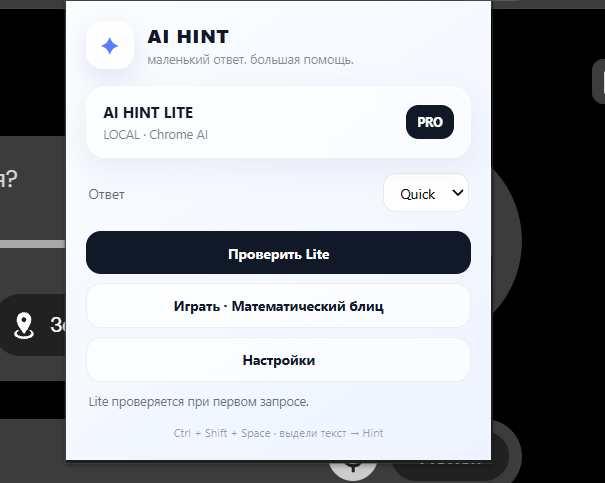

# AI Hint

**A small, fast helper for selected text in Chrome.** Select a short fragment, press `Ctrl+Shift+Space`, and get a concise answer beside the text.

AI Hint has two modes:

- **Lite** uses Chrome's built-in on-device AI when the browser and device support it. The selected text stays on the device for this mode.
- **Pro** sends the selected text to the provider you choose, using your own API key. Supported providers: OpenAI, Google Gemini, Anthropic Claude, DeepSeek, and Yandex AI Studio.

The extension also includes a local, offline 60-second arithmetic game.

## Install from source

1. Download or clone this repository.
2. Open `chrome://extensions` in Chrome and turn on **Developer mode**.
3. Select **Load unpacked** and choose the project folder containing `manifest.json`.
4. Pin AI Hint from Chrome's extensions menu.
5. Select text on a regular web page and press `Ctrl+Shift+Space`, or right-click the selection and choose **AI Hint — спросить о выделенном**.

If the shortcut is already in use, set another one at `chrome://extensions/shortcuts`. Chrome may not allow extensions to run on browser-internal pages, the Chrome Web Store, or some restricted pages.

## Use AI Hint

- Choose **Lite** for local Chrome AI, when available.
- Choose **Pro** to select a provider, enter your own API key, and grant that provider's optional network access.
- Set answer depth to Quick, Smart, or Deep.
- In settings, choose the bubble auto-close time and whether to show follow-up buttons.
- Open the popup and choose **Играть · Математический блиц** to play offline.

Lite requires a compatible Chrome version and device. The extension reports availability in its settings; it does not require an API key for Lite.

## Data and privacy

AI Hint does not include analytics or telemetry. It reads the text you explicitly select when you invoke the feature. Lite processes that text with Chrome's on-device model when available. Pro sends the selected text and follow-up prompts to the provider you selected; that provider's own privacy terms apply. API keys, settings, and the game's high score are stored in Chrome extension-local storage. See the [Privacy Policy](PRIVACY.md).

## Project status

Current version: **2.2.0**. See [the roadmap](ROADMAP.md) for planned work and [Chrome Web Store preparation](docs/CHROME_WEB_STORE.md) for listing copy and the submission checklist.

## Development

The project is a dependency-free Manifest V3 extension. Each push and pull request builds a clean ZIP package and runs a secret scan. On GitHub, download the `ai-hint-chrome-extension` artifact from the **Actions** run to get the package.

## License

No license has been declared yet. All rights are reserved unless a license is added by the project owner.
